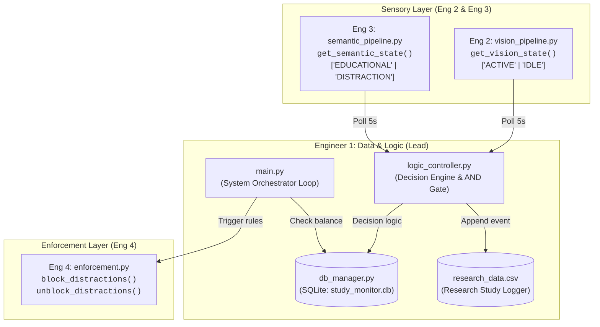

# AI-Driven Contextual Study Monitor (PC/Desktop)

> **Lead / Engineer 1 Deliverable:** Data Architecture, State Controller & System Orchestration.

An automated desktop productivity monitor that tracks user engagement using physical sensors (webcam / computer vision) and digital context (active window classification), dynamically rewarding focused study time and enforcing OS-level website blocks when time expires.

---

## 🏗️ System Architecture



---

## 🧠 The Decision Engine ("The AND Gate")

Every polling cycle (default: 5 seconds), `logic_controller.py` evaluates the user's combined physical and digital state:

| Physical State (`vision`) | Digital State (`semantic`) | Verdict | Balance Delta | Behavior |
| :--- | :--- | :--- | :--- | :--- |
| **`ACTIVE`** (Attentive) | **`EDUCATIONAL`** (Studying) | **Reward** | `+1s` | *"Both Active: Accruing Time"* |
| **`IDLE`** (Asleep / Away) | **`EDUCATIONAL`** (Study Tab) | **Override** | `-1s` | *"Vision Override: User Inactive"* |
| **`ACTIVE`** (Attentive) | **`DISTRACTION`** (Social Media) | **Drain** | `-1s` | *"Distraction active"* |
| **`IDLE`** (Away) | **`DISTRACTION`** | **Drain** | `-1s` | *"Idle distraction"* |

---

## 📁 Repository Structure

```
GetALifeJosy/
│
├── 🧠 Engineer 1 Core Components
│   ├── db_manager.py                 # SQLite persistence, user balance & transaction logs
│   ├── logic_controller.py           # The AND Gate decision engine & CSV logging
│   └── main.py                       # Master orchestrator loop & graceful shutdown
│
├── 🧪 Checkpoint Test Suites
│   ├── test_db_manager.py            # Checkpoint 1: Database persistence across restarts
│   ├── test_logic_controller.py      # Checkpoint 2: The "Brain" AND Gate & Vision Override
│   └── test_system_orchestration.py  # Checkpoint 3: Zero-Balance & Earn-and-Burn tests
│
├── 🔌 Sensory & OS Module Contracts (Stubs for Teammates)
│   ├── vision_pipeline.py            # Eng 2 Contract Stub: get_vision_state()
│   ├── semantic_pipeline.py          # Eng 3 Contract Stub: get_semantic_state()
│   └── enforcement.py                # Eng 4 Contract Stub: block/unblock_distractions()
│
└── 📋 Documentation & Logs
    ├── Team Implementation Roadmap.md # Master project roadmap and sprint phases
    ├── README.md                     # This file
    ├── study_monitor.db              # Auto-generated SQLite database
    └── research_data.csv             # Auto-generated experiment dataset
```

---

## 🚀 Getting Started

### Prerequisites
- Python 3.10+ (Tested on Python 3.14).
- Standard Python libraries used for Engineer 1 core modules (no third-party dependencies required for DB and logic).

---

## 🧪 Running the Checkpoint Test Suites

Run each verification test independently to validate all integration checkpoints:

```powershell
# Checkpoint 1: Database persistence across process restarts
python test_db_manager.py

# Checkpoint 2: The Decision Engine & Vision Override
python test_logic_controller.py

# Checkpoint 3: End-to-end System Orchestration & OS Enforcement
python test_system_orchestration.py
```

Or run all 3 suites together:
```powershell
python test_db_manager.py; python test_logic_controller.py; python test_system_orchestration.py
```

---

## 💻 Running the Live System

### Standard Run (5-Second Polling Loop)
```powershell
python main.py
```

### CLI Options & Testing Modes
```powershell
# Fast demo mode: 1-second ticks, starting with 10 units balance, runs for 6 cycles
python main.py --poll-interval 1.0 --reset-balance 10 --max-cycles 6

# Zero-balance test mode: Starts at 0 to test immediate enforcement
python main.py --reset-balance 0
```

### Options Reference:
- `--poll-interval <seconds>`: Cycle duration in seconds (default: `5.0`).
- `--reset-balance <int>`: Explicitly seed the starting balance.
- `--max-cycles <int>`: Automatically stop execution after $N$ cycles.

---

## 🤝 Handover Contracts for Teammates

Teammates simply fill in the implementation of their respective stub files without modifying the core logic:

| Role | Target File | Function Contract | Expected Return |
| :--- | :--- | :--- | :--- |
| **Engineer 2 (Vision)** | `vision_pipeline.py` | `get_vision_state()` | `"ACTIVE"` or `"IDLE"` |
| **Engineer 3 (NLP/Semantics)** | `semantic_pipeline.py` | `get_semantic_state()` | `"EDUCATIONAL"` or `"DISTRACTION"` |
| **Engineer 4 (OS Enforcement)** | `enforcement.py` | `block_distractions()`<br/>`unblock_distractions()` | `bool` / `None` |

---

## 🛡️ Safety & Graceful Shutdown (Task 4.2)

To ensure users are never permanently blocked from web access if the application terminates unexpectedly, `main.py` incorporates:
- `signal.signal(signal.SIGINT, ...)`: Handles `Ctrl+C`.
- `signal.signal(signal.SIGTERM, ...)`: Handles process kill signals.
- `atexit.register(...)`: Guarantees `enforcement.unblock_distractions()` executes before the process terminates under any condition.
